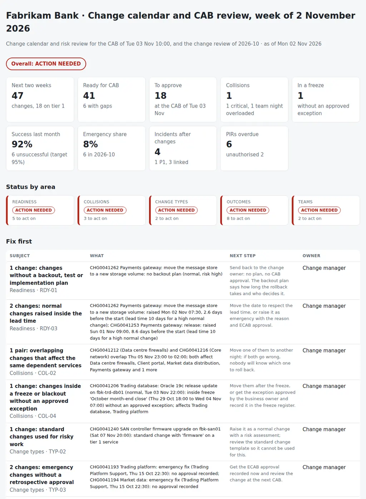

# Change Calendar and Risk Review

The weekly CAB and the monthly change review: which changes are scheduled for the next two weeks, which of them are risky or not ready for the CAB, which collide, and how last month's changes went. From the change requests, the business service map, the freeze register, the incidents and the approvals exported from ServiceNow (or Jira Service Management and other tools) it puts together:

- **Readiness for the CAB:** changes without a backout, test or implementation plan, with the risk not assessed or below what the impact and the tier of the service suggest, raised inside the lead time, not approved yet when they start before the CAB, without an owner, or outside the maintenance window of their tier.
- **Collisions:** overlapping changes on the same CI or business service, changes that affect the same critical services through the dependencies (the firewall and the core switches the same night), too many changes for one team on one night, and changes inside a freeze or blackout window without an approved exception.
- **Emergency and standard changes:** the emergency share by month and its reasons, standard changes used for risky work, and emergency changes never approved afterwards.
- **Outcomes:** last month's success rate and the trend, unsuccessful changes, incidents linked to a change or opened on the same service within hours of one, changes that overran their window, unauthorised work, and post-implementation reviews overdue.
- **Teams:** assignment groups with a low success rate, or a high or rising share of emergency changes.

Five CSVs, one JSON with the policy and one Python command give each area a status (**on track**, **attention** or **action needed**), an overall verdict, a two-week calendar by day and service with the collisions highlighted, and the CAB pack: **what to approve, what to move, and what last month taught us.**

Python 3.10+, standard library only. It runs with fictional demo data out of the box. A read-only PowerShell exporter for the ServiceNow Table API is included.



## Why

The change calendar in the ITSM tool is a list. It does not say which two changes on that list will take the trading floor down together. In a typical week:

- the network security team upgrades the data centre firewalls on Thursday night, and the network team upgrades the core switches the same night, both approved on their own merits, both in the path of the trading platform, market data and payments;
- a database patch on the trading platform is scheduled on the second night of the month-end close freeze, approved by a CAB that did not look at the freeze register;
- a high-risk payments change is raised on Monday morning for Wednesday night, with no backout plan;
- a storage controller firmware upgrade is booked as a standard change, so it never reaches the CAB;
- one team raises a third of its changes as emergencies, more every month, for the same two reasons;
- last month a load balancer change closed as successful two hours before a P1 at the market open, and its post-implementation review is still not booked.

The change records know the plans, the risk and the dates; the CMDB knows which services depend on which; the freeze register knows when nothing should change; the incidents know what broke afterwards; the approvals know who said yes and when. The review that matters joins them before every CAB. The rules are in `settings.json` and `changecal/checks.py`.

## What it checks

| Area | Code | Finding |
|---|---|---|
| Readiness | RDY-01 | No backout, test or implementation plan, by type (critical for high risk or tier 1) |
| Readiness | RDY-02 | Risk not assessed, or lower than the impact and the tier of the service suggest |
| Readiness | RDY-03 | Normal change raised inside the lead time for its risk (critical for high risk) |
| Readiness | RDY-04 | Not approved: critical if it starts before the CAB or was rejected; for information when it is on this or the next CAB's agenda |
| Readiness | RDY-05 | No assignment group or assignee |
| Readiness | RDY-06 | Outside the maintenance window of its tier, or flagged outside the maintenance schedule |
| Collisions | COL-01 | Overlapping changes on the same CI or business service |
| Collisions | COL-02 | Overlapping changes that affect the same services of tier `collision_max_tier` or above through the dependencies (critical on tier 1) |
| Collisions | COL-03 | More than `max_changes_per_team_night` changes for one team on one night |
| Collisions | COL-04, COL-05 | Inside a freeze without an approved exception, or any change inside a blackout (critical); inside a freeze with an exception or allowed as an emergency (information) |
| Change types | TYP-01, TYP-04 | Emergency share last month above `emergency_share_max`; the emergency reasons (information) |
| Change types | TYP-02 | Standard change with high risk, or matching `standard_risky_match` (firmware, upgrade, migration) on a tier 1 or 2 service |
| Change types | TYP-03 | Emergency change with no approval, or approved more than `retro_approval_days` after the work |
| Outcomes | OUT-01 | Success rate last month below `success_target` |
| Outcomes | OUT-02 | Unsuccessful changes last month |
| Outcomes | OUT-03 | Incidents linked to a change (caused by), or a P1/P2 on the same CI or an affected service within `incident_window_hours` (suspected) |
| Outcomes | OUT-04 | Finished more than `overrun_tolerance_minutes` after the planned end |
| Outcomes | OUT-05 | Unauthorised: raised after the work started, or a normal change approved after the work started |
| Outcomes | OUT-06 | Post-implementation review overdue (unsuccessful, with issues, emergency, or followed by an incident) |
| Teams | TEAM-01 | Success rate over the last months below `team_success_min` |
| Teams | TEAM-02 | Emergency share above `team_emergency_share_max` and rising, or above it over the period |

## Outputs

| File | What |
|---|---|
| `report.html` | Overall verdict, tiles, status by area, "Fix first", the two-week calendar by day and business service with collisions, freezes and gaps highlighted, and one section per area: readiness, collisions and freezes, emergency and standard changes, outcomes by month, teams, and all findings |
| `cab-pack.md` | The CAB pack: status by area, headlines, sources, the changes to approve with their gaps and a decision column, collisions to resolve, freezes and exceptions, readiness gaps, standard and emergency changes, last week's outcomes, the change review by month with the incidents after changes, PIRs due, teams, findings, actions and sign-off |
| `calendar.csv` | Every change in the next two weeks: type, state, risk, approval, CI, business services, tier, impacted services, group, window, night, freeze, the changes it collides with, verdict and issues |
| `collisions.csv` | Overlapping pairs, team nights over the limit and changes inside a freeze |
| `readiness.csv` | Every change in the calendar with its lead time, approval, plans and window |
| `outcomes.csv` | Every change of the last months: outcome, overrun, incidents, PIR required, due and status |
| `teams.csv` | Changes, success rate, unsuccessful and emergency share by month for each assignment group |
| `actions.csv`, `findings.csv` | The findings with owner and next step, ready for a tracker |

## Try it

```bash
git clone https://github.com/inigogonzalezgarcia/40-change-calendar-risk-review.git
cd 40-change-calendar-risk-review
python -m changecal demo
```

Open `output/report.html` and `output/cab-pack.md`.

### The demo data

The demo is a made-up bank with a trading floor, Fabrikam Bank, reviewed on Monday 2 November 2026, the morning before the weekly CAB:

- 16 business services in three tiers (core network, data centre firewalls, SAN storage, Active Directory, the trading platform and its database, market data, payments, the general ledger, the client portal, risk reporting, workplace…) with their dependencies, and 37 CIs;
- 263 change requests from nine assignment groups (216 from August to October, 47 in the next two weeks), 324 approvals, 123 incidents, and a freeze register with the October month-end close, an index rebalance and the year-end freeze.

All CIs, changes, incidents and people are fictional. The problems are placed on purpose:

- **Collision:** the PAN-OS upgrade of the data centre firewalls and the NX-OS upgrade of the core switches overlap on Thursday 5 November; both affect the trading platform, market data, payments and the client portal.
- **Freeze:** an Oracle release update on the trading database on Tuesday 3 November, inside the October month-end close freeze with no exception (an emergency fix the night before and a firewall rule with an approved exception during the index rebalance are allowed).
- **Readiness:** a high-risk payments change raised on Monday morning for Wednesday night with no backout plan; a purge of the trading database rated low risk; a change with the risk not assessed; a certificate renewal at lunchtime on a tier 2 service; a change with no assignment group; four Windows changes for one team on Sunday night.
- **Standard for risky work:** a SAN controller firmware upgrade booked as a standard change.
- **Emergencies:** Trading Platform Support's emergency share rising from 10% to 22% to 36% from August to October, two of them never approved.
- **Outcomes:** 92% successful in October against 95%; a load balancer change on market data followed by a P1 two hours after it finished, at the open; a P2 on the client portal the morning after a release, not linked; a certificate replaced on the payments gateway without a change and raised the next day; a database update approved three days after it was done; three overruns; six PIRs overdue.
- **Teams:** Middleware & Integration with 61% of its changes successful over three months.

## Use it with your own data

1. Export ServiceNow (read-only):
   ```powershell
   .\scripts\Export-ChangeData.ps1 -Instance contoso -OutputFolder .\data
   ```
   - Table API, `GET /api/now/table/{table}` with `sysparm_query`, `sysparm_fields`, `sysparm_display_value=true` (labels and names instead of sys_ids), `sysparm_exclude_reference_link=true`, and `sysparm_limit` / `sysparm_offset` paging.
   - `change_request` (planned start from three months ago to two weeks ahead), `incident` (with `caused_by`), `sysapproval_approver` for change requests, and the business services from `cmdb_ci_service` with their `Depends on::Used by` relationships in `cmdb_rel_ci`.
   - Basic authentication from `Get-Credential`, never stored, or an OAuth access token with `-BearerToken`.
   - Jira Service Management or another tool: export the same columns; the usual headers (`Issue key`, `Summary`, `Change type`, `Change risk`, `Planned start`, `Planned end`, `Affected services`) are accepted.
2. Add `freezes.csv`: the freezes and blackout windows with their scope and the approved exceptions.
3. Adjust `data/settings.json`: the CAB day, the lead times by risk, the plans required by type, the maintenance windows by tier and the thresholds ([docs/data-format.md](docs/data-format.md)).
4. Build the outputs:
   ```bash
   python -m changecal review data/ --title "Change calendar and CAB review · week of 2 November 2026"
   ```

[docs/cab-runbook.md](docs/cab-runbook.md) has the export, the agenda of the weekly CAB and of the monthly change review, how to handle freezes and exceptions, and how to read each signal.

The exports contain system names, people and the incidents of each service. Keep them inside your organisation:

- real files at the top level (`changes*.csv`, `ci-services*.csv`, `freezes*.csv`, `incidents*.csv`, `approvals*.csv`, `settings.json`, `data/`) and the `output/` folder are excluded from Git by `.gitignore`;
- only the fictional files in `sample_data/` are committed.

## Tests

```bash
pip install -r requirements-dev.txt
python -m pytest -q
```

GitHub Actions runs them on Python 3.10 and 3.12 on every push, then rebuilds the fictional sample data and the report screenshot from the simulator.

15 tests: the ServiceNow export with display values and raw states, and a Jira Service Management export; the service map with tiers and dependencies, the freeze register, the incidents, the approvals and the settings; plans, risk against impact and tier, and lead time; approval against the CAB, owner and the maintenance windows across midnight and the weekend; collisions on the same CI, the same service and through the dependencies; team nights, freezes, blackouts and exceptions; emergency share, reasons and standard changes for risky work; retrospective approval; success rate, unsuccessful changes and overruns; incidents linked and suspected; unauthorised work and overdue reviews; teams; status by area and overall; and the demo end to end (deterministic, all nine outputs).

## Next steps

- Read the change calendar through the API on a schedule, so the pack is ready on Monday morning without exports, and post the agenda to the CAB channel.
- Read the freezes from the blackout schedules of the ITSM tool instead of a CSV.
- Write the decisions of the CAB back as work notes on each change, through a reviewed and separately approved integration.
- Compare each week with the previous one: changes moved, collisions resolved, PIRs closed.

## Background

Built from my work in IT service management for offices with a trading floor:

- process owner for incidents, changes (the CAB) and problems, and participant in CABs and in go-live and service acceptance reviews;
- release management: planning, testing, rollback and post-release validation;
- procedures and runbooks for the incident, change and release processes, and training others to use them;
- leading the technical response in major incidents, and the post-mortems and root cause analysis afterwards;
- ServiceNow, EasyVista and HaloITSM; Jira and Confluence administration with Agile and Scrum; ITIL practice;
- supervising DR and business continuity tests, and supporting about 2,500 users across European offices.

Written from scratch with fictional data; no employer data, systems or exports are used.

## Customisation and contact

Want this adapted to your environment? For example:

- your ServiceNow instance, Jira Service Management, EasyVista or HaloITSM exports;
- your change policy: lead times, plans required, risk matrix and maintenance windows;
- your service map and freeze register;
- the CAB pack in the format of your CAB.

Get in touch:

- Website (contact form): [inigogonzalezgarcia.github.io](https://inigogonzalezgarcia.github.io/about.html#contacto)
- LinkedIn: [linkedin.com/in/igonzalez93](https://www.linkedin.com/in/igonzalez93)

## License

MIT
